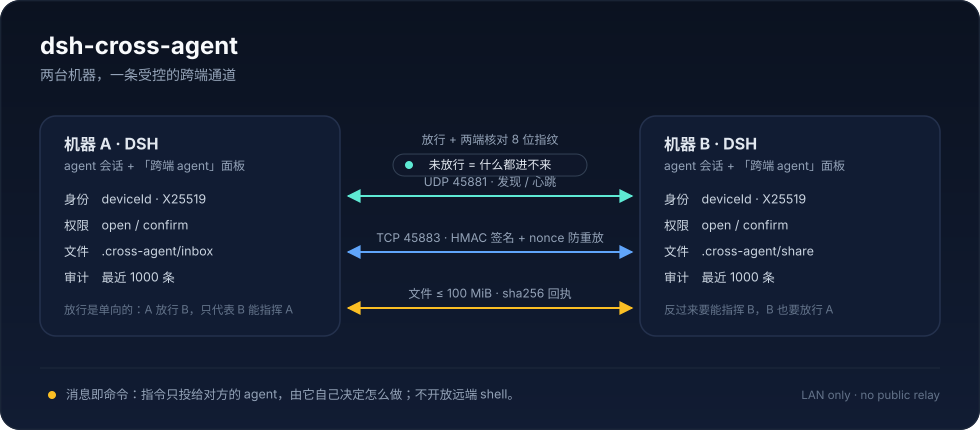

# dsh-cross-agent

[](https://github.com/Diomchen/dsh-cross-agent/actions/workflows/ci.yml)
[](https://www.npmjs.com/package/dsh-cross-agent)
[](LICENSE)
[](package.json)
[](https://github.com/topics/dsh-plugin)

**让同一局域网里两台机器上的 [DeepSeek Harness](https://github.com/deepseek-ai/deepseek-harness) 互相看见、放行、下指令、传文件、调工具。**

不开放远端 shell，不做公网中继。一份 DSH 实例养一个身份；只有你放行过的对端才能说话。

> Two DeepSeek Harness instances on the same LAN can discover each other, explicitly allow a peer, deliver prompts into a `跨端 · <peer>` session, exchange files with SHA-256 receipts, and call named tools only when the peer allow-lists them. No remote shell, no public relay.



## 目录

- [它解决什么](#它解决什么)
- [安装](#安装)
- [两台机器怎么连（零配置）](#两台机器怎么连零配置)
- [安全模型](#安全模型)
- [给 agent 的七个工具](#给-agent-的七个工具)
- [人的命令](#人的命令)
- [配置](#配置)
- [给对端起别名](#给对端起别名只在本机生效)
- [跨端工具：先想清楚再开](#跨端工具先想清楚再开)
- [排错](#排错)
- [兼容性与限制](#兼容性与限制)
- [开发](#开发)
- [发版](#发版)
- [English](#english)

## 它解决什么

两台机器各跑一份 DSH，通常会变成两座孤岛：模型、会话、工作区都在各自机器上。  
这个插件把「另一台机器上的 agent」变成你可以用一句话调用的对端：

- **消息即命令**：A 让 B 做事，只是在 B 的跨端会话里投递一条文字。B 的 agent 自己决定怎么做，
  本机的权限、沙箱、审批仍然生效。插件**不提供远端 shell**（[ADR-0001](docs/adr/)）。
- **放行是连接的根**：未放行的对端，任何请求都进不了会话或收件箱；放行还是**单向**的。
- **默认要人点头**：`confirm` 模式下每条指令、每个文件都进「待审核」队列；切成 `open` 要二次确认。
- **跨端工具默认全关**：`exposedTools` 为空就是一个都不给；名单外的调用一律 `403` 并记审计（[ADR-0004](docs/adr/)）。
- **连接可核对**：两端用 X25519 + HKDF 派生同一把密钥，显示同一个 8 位指纹；每个请求都有
  HMAC-SHA256 签名、±60 秒时间窗与 nonce 防重放。
- **看得见**：面板里能看到在线状态、待办、传输记录和最近 1000 条审计。

一个典型用法：

```text
你：让家里的 Windows 把 D:\work\report 里的最新 PDF 发过来
agent：调用 peer_list → peer_ask("家里的 Windows", "把 report 目录里最新的 PDF 发给我")
       对方 agent 执行后调用 peer_file_send，文件落到本机 .cross-agent/inbox/家里的 Windows/
```

## 安装

需要：**DSH 0.2.x**（在 0.2.2-rc.1 上做过真机双向联调）、**Node.js ≥ 22.12**、两台机器在同一网段。

**从 npm 装（推荐）**：

```sh
# 在普通终端里跑，不要在 agent 会话里跑（pnpm 的 store 不在 workspace 沙箱里）
dsh plugin --profile desktop add dsh-cross-agent

# Web profile 把 desktop 换成 web
dsh plugin --profile web add dsh-cross-agent
```

**从 GitHub Release 装**（CI 产出的 tgz，附 `SHA256SUMS.txt`）：

```sh
gh release download -R Diomchen/dsh-cross-agent --pattern '*.tgz' --dir .
dsh plugin --profile desktop add "file:$PWD/dsh-cross-agent-<version>.tgz"
# Windows PowerShell 用完整路径：
# dsh plugin --profile desktop add "file:$env:USERPROFILE\.dsh\packages\dsh-cross-agent-<version>.tgz"
```

**从源码目录装**（改过代码、想立刻试）：

```sh
dsh plugin --profile desktop add "file:/绝对路径/dsh-cross-agent"
```

装完**重启 DSH**。确认宿主半侧起来了：

```sh
curl -s http://127.0.0.1:<DSH端口>/cross-agent/state | jq '.state.self'
```

> 这个端点只接受回环地址；浏览器面板走同源 `fetch`，不需要额外令牌。

升级用同一个 `add` 命令装新版本；回滚就装回旧包。Windows 的完整步骤与三个常见坑见 [WINDOWS.md](WINDOWS.md) §2。

## 两台机器怎么连（零配置）

1. 两台机器装同一个插件，确认**在同一网段**，防火墙放行 `45881/udp` 与 `45883/tcp`。
   macOS 首次监听会问「允许传入连接」；Windows 要给**专用网络**放行。
2. 打开任意一端的 Web UI，进侧栏的「跨端 agent」。几秒内对端会出现在「对端」里，
   状态是「在局域网里发现了它」。
3. 点「请求连接」→ 对方面板的「需要你决定」里出现一条「连接请求」→ 对方点「放行」。
4. 两端显示同一个**指纹**（8 个十六进制字符）。不一致就说明中间有人在动包，别继续。
5. 默认模式是「需要审核」。要让它不打扰人，在那一侧把权限模式切成「完全开放」并二次确认。

注意：**放行是单向的**。A 放行 B = 允许 B 给 A 的 agent 下指令；要让 A 也能指挥 B，B 也要放行 A。
两边都放行之后，两端会各建一个 `跨端 · 对方名字` 的会话。

广播被 Wi-Fi 挡掉（企业网常见：单播通、广播不通）时，用 `/cross-agent probe <对端IP>` 单播唤醒，
或把静态地址写进 `peerAddresses`。同一台机器上两份 DSH 见[下一节](#两台机器之外的场景)。

### 两台机器之外的场景

- **同一台机器上两份 DSH**（两个 profile / 两个 `DSH_HOME`）：UDP 广播在回环上不一定互相送到，
  插件额外走一条**本机注册表** `$DSH_HOME/dsh-cross-agent/instances/*.json`。
  两边共享同一个 `DSH_HOME` 时自动生效；完全独立的两个 `DSH_HOME` 需要手动指定 `registryDir`。
- **公网 / NAT 穿透**：不做。需要的话看 DSH 官方的 liveshare。

## 安全模型

| 层 | 机制 | 没有做什么 |
|---|---|---|
| 身份 | 每份 DSH 一个 `deviceId` + X25519 长期密钥；连接时核对 8 位指纹 | 没有证书链，也没有第三方目录 |
| 传输 | 每个请求 HMAC-SHA256 签名（method / path / ts / nonce / body hash）；±60 秒时间窗；nonce 防重放 | 局域网内是明文 HTTP，**没有 TLS**；HMAC 只保证完整性与来源，不保密内容 |
| 授权 | 显式放行；放行单向；`open` / `confirm` 两种模式；待审核 5 分钟过期 | 不按 IP 白名单代替放行，也不信任「同网段」本身 |
| 工具 | `exposedTools` 默认空；名单外 403 + `denied` 审计；`confirm` 模式下每次调用都要对方点头 | **不区分参数**：开放 `read_file` 就等于开放它够得着的所有路径 |
| 数据 | 数据目录 `0700`、文件 `0600`；收件箱 1 GiB / 500 件；单件 ≤100 MiB；审计 1000 条环形 | 不做内容扫描，也不做病毒扫描 |

一句话：**这是给可信局域网用的工具**。不要在不可信网络里把 `open` 模式当作默认；
不要把 `bash` / `write` 这类能改本机状态的工具放进 `exposedTools`，除非你确实想让对方改你的机器。

## 给 agent 的七个工具

| 工具 | 做什么 |
|---|---|
| `peer_list` | 谁在线、是否已放行、什么模式、指纹 |
| `peer_ask` | 给对方 agent 下一条指令，等它答复（默认 120 秒，上限 600 秒）；带 `session_id` 可投到对方为你建的会话 |
| `peer_session_create` | 让对方在它某个目录下新建一条会话——目录即项目分组（已有目录复用，新目录当场注册） |
| `peer_file_send` | 推一个文件过去（≤100 MiB，sha256 回执） |
| `peer_file_fetch` | 从对方共享目录拉一个文件（只读，不能越界） |
| `peer_tools` | 对方对外开放了哪些工具 |
| `peer_tool` | 调用对方**白名单里**的一个工具（`confirm` 模式下每次都要对方点头） |

`peer_ask` 的延迟是**对方一次 agent turn**，不是 RPC。对方 `confirm` 模式下它的人可能拒绝或超时；
超时返回 `ok:false` + `correlationId`，之后可以带 `correlation_id` 再查一次。

`peer_session_create` 的权限有个硬边界：**远端可以往紧里调，不能自己往松里调**。
新会话能开到哪一档，由接收方配置里的「按目录上限」决定，超出就夹住并在结果里标 `clamped: true`。
结果里的 `permission` 是**解析出的目标档**；`applied` / `effective` / `verified` 才是实际生效情况。
`applied: false` 表示宿主没有把权限设上（例如会话还没注册、`permissionPresets` 不可用），
这时不要把它当成目标权限的会话——`effective` 会给出实际档，读不到就是 `null`。

## 人的命令

```text
/cross-agent status                 # 本机身份、端口、对端概况
/cross-agent pending                # 待审核列表 + id
/cross-agent approve <id>           # 同意一条待办（连接 / 指令 / 文件）
/cross-agent reject <id>
/cross-agent connect <名字>         # 发起连接
/cross-agent allow <名字>           # 放行（= 允许对方指挥本机 agent）
/cross-agent mode <名字> open --yes # 切成完全开放，必须带 --yes
/cross-agent mode <名字> confirm    # 改回每条都问
/cross-agent block <名字>
/cross-agent alias <名字> [新别名]   # 起/改本机别名；不写新别名 = 清除
/cross-agent rename <新名字>        # 改本机显示名（对端下次握手时看到）
/cross-agent probe <IP>             # 单播探针，广播被挡时用
```

## 配置

在 profile 的插件配置里（或 `cordis.yml` 的对应行）：

| 键 | 默认 | 说明 |
|---|---|---|
| `discoveryPort` | `45881` | UDP 发现端口；同网段所有机器要一致 |
| `port` | `45883` | RPC 与文件传输端口 |
| `displayName` | 主机名 | 本机在局域网里显示的名字 |
| `inboxDir` | `<工作目录>/.cross-agent/inbox` | 收到的文件落到哪 |
| `shareDir` | `<工作目录>/.cross-agent/share` | 允许对端拉取的共享目录 |
| `shareRoots` | `[]`（= 只有 `shareDir`） | 共享目录白名单，可以给多个根 |
| `peerAddresses` | `[]` | 静态对端地址；广播被挡时每拍单播探针 |
| `registryDir` | `$DSH_HOME/dsh-cross-agent/instances` | 同机多实例的注册表目录；两个独立 `DSH_HOME` 想互相发现时手动指定 |
| `exposedTools` | `[]` | 允许对端通过 `peer_tool` 调用的本机工具名；**默认空 = 一个都不开** |

会话权限（`peer_session_create` 用）：

| 键 | 默认 | 说明 |
|---|---|---|
| `sessionPermissionRules` | `[]` | `[{ path, preset }]`，按目录给新会话定上限；最长前缀匹配 |
| `sessionPermissionDefault` | `workspace-write` | 没命中规则时的权限档 |
| `allowRemotePermissionRaise` | `false` | 允许远端把权限提到高于目录规则；默认只能往紧里调 |
| `allowRemoteSessions` | `true` | 是否允许远端建会话；关掉就是 403 |

```yaml
# 接收方：按目录给新会话定权限上限（最长前缀匹配）
sessionPermissionRules:
  - { path: /Users/you/work/public, preset: workspace-write }
  - { path: /Users/you/work/secret, preset: read-only }
sessionPermissionDefault: workspace-write
allowRemotePermissionRaise: false
allowRemoteSessions: true
```

环境变量：`DSH_CROSS_AGENT_HOME`（数据目录，默认 `$DSH_HOME/dsh-cross-agent`）、
`DSH_CROSS_AGENT_DISCOVERY_PORT`、`DSH_CROSS_AGENT_PORT`。

数据目录：

```text
$DSH_HOME/dsh-cross-agent/
  data/identity.json     deviceId、显示名、X25519 密钥对
  data/peers.json        连接表（状态、模式、共享密钥、指纹）
  data/approvals.json    待审核队列
  data/grants.json       "记住 24h" 的授权
  data/transfers.json    最近 500 次传输
  data/results.json      最近 200 条指令结果（按 correlationId 复查）
  data/audit.json        最近 1000 条审计（环形）
  instances/<deviceId>.json   同一台机器上的实例注册表
```

## 给对端起别名（只在本机生效）

对端卡片上的机器名（比如 `DESKTOP-699DN63`）不好记，点名字旁边的铅笔就能起个别名，比如「家里的 Windows」。
别名只存本机，不会传给对端，也不会改对端自己的显示名或已经建好的跨端会话标题。
之后面板、搜索，以及 agent 工具的 `peer` 参数（`peer_ask` / `peer_file_send` …）都能直接用这个别名：

```text
/cross-agent alias DESKTOP-699DN63 家里的 Windows
/cross-agent alias DESKTOP-699DN63          # 清除别名
```

别名里有空格时，命令里用引号括起来：`/cross-agent mode "家里的 Windows" confirm`。
面板上点按钮不需要引号。

本机的名字（对端看到的显示名）在「详情 → 本机名」里改，或 `/cross-agent rename <新名字>`；
对端下次握手时会看到新名字。

## 跨端工具：先想清楚再开

`exposedTools` 是「工具名」级别的白名单，**不区分参数**。开放一个 `read_file`，就等于让对方能读那个工具能到的所有路径。
所以：

- 默认是空的，不是「没配置」；想用先在这里点名；
- 别开 `bash` / `write` 这类「能改变本机状态」的工具，除非你确实想让对方改你的机器；
- 对方试探白名单外的名字会被 `403` 并记进审计（`denied`）；
- 名字先用 `peer_tools` 查，不要猜。

```json
{ "exposedTools": ["read_file"], "shareRoots": [".cross-agent/share", "docs"] }
```

## 排错

| 症状 | 先看什么 |
|---|---|
| 对端一直不出现 | 同一网段？`45881/udp` 放通了？macOS 首次监听会问「允许传入连接」，Windows 要给**专用网络**放行 |
| 看得见端口、就是发现不到 | 企业 Wi-Fi 常丢广播（客户端隔离）。用 `/cross-agent probe <对端IP>` 单播唤醒，或把静态对端写进 `peerAddresses` |
| 看得见但连不上 | `45883/tcp` 被挡；或对方从没点过「放行」 |
| 一直 `clock-skew` | 两台机器的时钟差超过 60 秒。插件会按对端 beacon 的钟自动对齐（窗口宽度不变），但差到小时级就要真的校时了：Windows 设置里「立即同步」 |
| 指令一直 `awaiting-review` | 对方是 `confirm` 模式，需要它的人点同意；5 分钟没人管就返回 pending |
| 指纹两端不一致 | 有人在中间动包，或一端删过 `identity.json`。删掉两边的 `peers.json` 重新放行 |
| 文件传一半失败 | 收件箱满了（1 GiB / 500 件）或超过单件 100 MiB；错误里会带原因 |
| 插件装完 DSH 起不来 | 端口被别的程序占了。换 `port` / `discoveryPort`，日志里会有一行 `[dsh-cross-agent]` 警告 |

更多宿主接口与踩坑记录见 [docs/harness-notes.md](docs/harness-notes.md)。

## 兼容性与限制

- **DSH**：0.2.x；在 0.2.2-rc.1 上真机验证过发现、放行、指令、文件、远端建会话。
  协议常量或 `inject` 形状变化时，两端要一起升级。
- **Node.js**：≥ 22.12（使用内建 `crypto` / `fetch`，零运行时依赖）。
- **系统**：macOS、Windows、Linux；Windows 的安装/防火墙细节见 [WINDOWS.md](WINDOWS.md)。
- **不做**：公网中继与 NAT 穿透、远端 shell、广播给多个对端、目录同步、断点续传、
  系统级桌面通知、传输加密（只有 HMAC 完整性 + 防重放）。

## 开发

```sh
node --test test/*.test.js    # 73 个单测：协议、存储、限流、审核、连接、文件、会话桥
node scripts/e2e.mjs          # 单进程双实例端到端（真实 HTTP/HMAC + 文件落盘）
node scripts/smoke.mjs        # 单机验收：以已放行对端的身份，给本机插件发真实签名请求
node scripts/smoke.mjs --security   # 再加一条：白名单外的工具名必须被拒
node scripts/smoke.mjs --full       # 再建会话 + 定向投递（会花一次 agent turn）
```

装完/升级完，`smoke.mjs` 是「这台机器还好不好使」的最短答案；它不需要第二台机器。

## 发版

本地打一个试装包：

```sh
npm run verify:pack   # 打包内容自检：必需文件齐全，测试/脚本没混进去
npm pack              # → dsh-cross-agent-<version>.tgz
```

正式发版走 CI（`.github/workflows/ci.yml`）：改 `package.json` 的 `version`、提交、打 tag。

```sh
git tag -a v0.2.9 -m "v0.2.9：README 与商店素材；registryDir 配置项"
git push origin main v0.2.9
```

流水线会先跑 4 组矩阵测试（ubuntu node 22/24、macos 22、windows 22；ubuntu 上再跑一次双实例端到端），
然后真实 `npm pack`，把 `dsh-cross-agent-0.2.9.tgz` 与 `SHA256SUMS.txt` 挂到 `v0.2.9` 的 Release。
tag 和 `package.json` 版本对不上会直接失败。

升级前先确认三件事：

1. **两端版本要一起走**：协议常量、`inject` 列表、宿主接口形状任一处变了，另一头必须同级或更新；
2. Windows 的安装/回滚步骤见 [WINDOWS.md](WINDOWS.md) §2（`dsh plugin --profile desktop add file:...`，
   不是在 agent 会话里跑）；
3. 发完在真机各跑一遍：`peer_tools`（验签名与时钟）、`peer_ask`（验会话桥）、
   `peer_session_create`（验建会话与权限夹取）。

## English

`dsh-cross-agent` connects two DeepSeek Harness instances on the same LAN: each host keeps its own
identity and agent, and an explicit allow-list decides who may speak. A connection carries prompts
into a `跨端 · <peer>` session, files up to 100 MiB with SHA-256 receipts, and named tool calls that
the receiving side must list in `exposedTools` first. There is no remote shell and no public relay.

```sh
dsh plugin --profile desktop add dsh-cross-agent
```

Open **跨端 agent** on both machines, request a connection, approve it on the other side, and compare
the 8-character fingerprint. The seven agent tools are `peer_list`, `peer_ask`, `peer_session_create`,
`peer_file_send`, `peer_file_fetch`, `peer_tools`, and `peer_tool`. Configuration, approval modes,
and troubleshooting are documented in the Chinese sections above.

## 许可证

MIT
